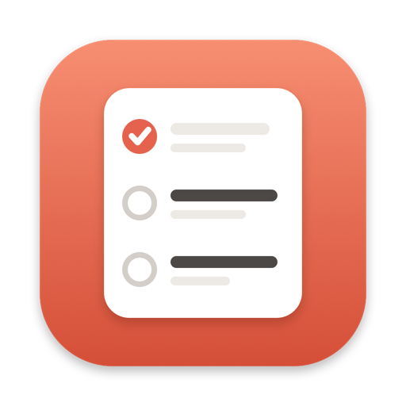
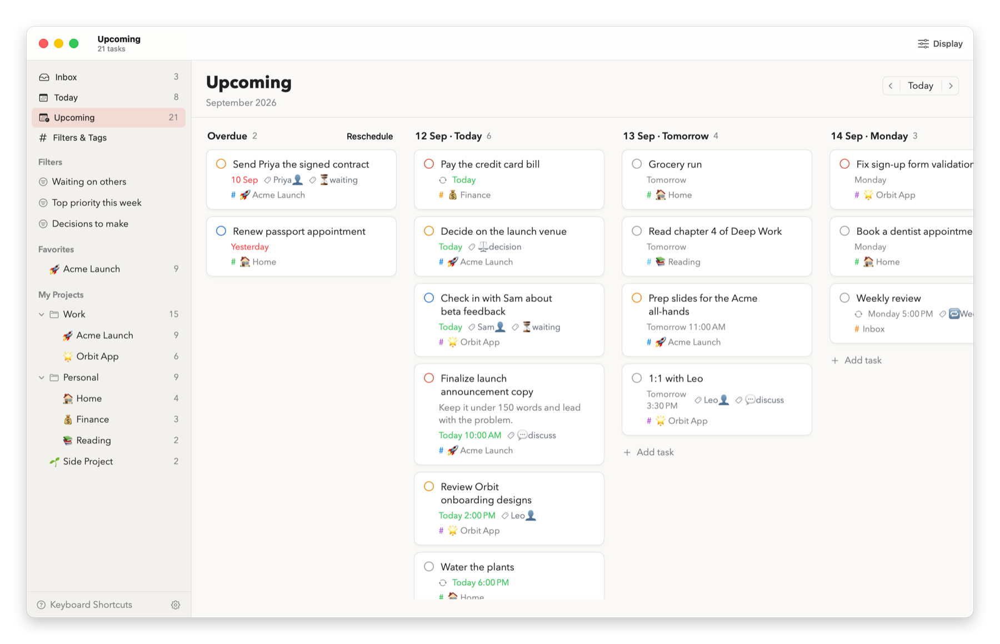
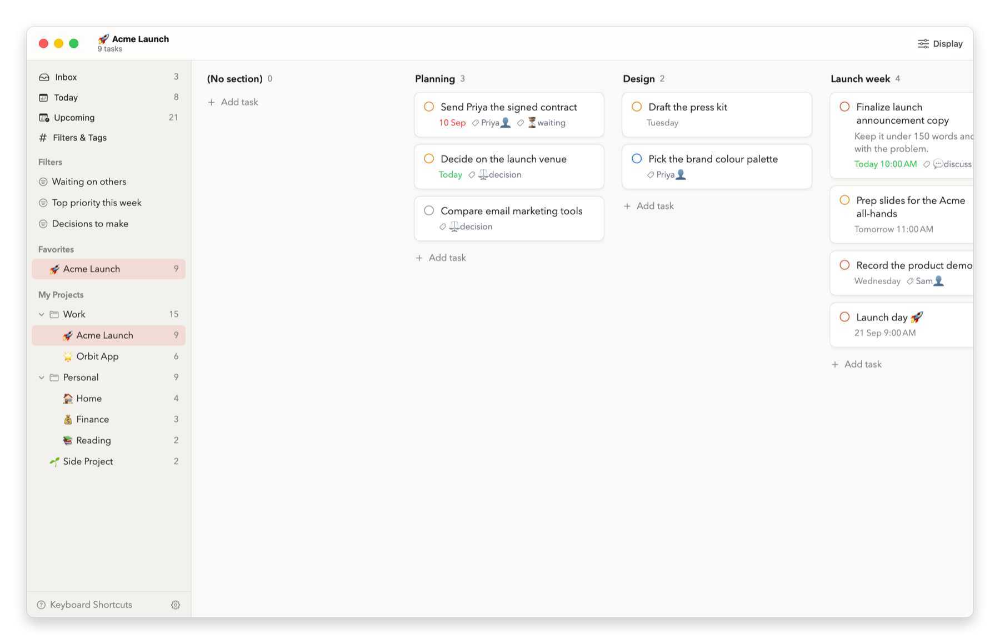
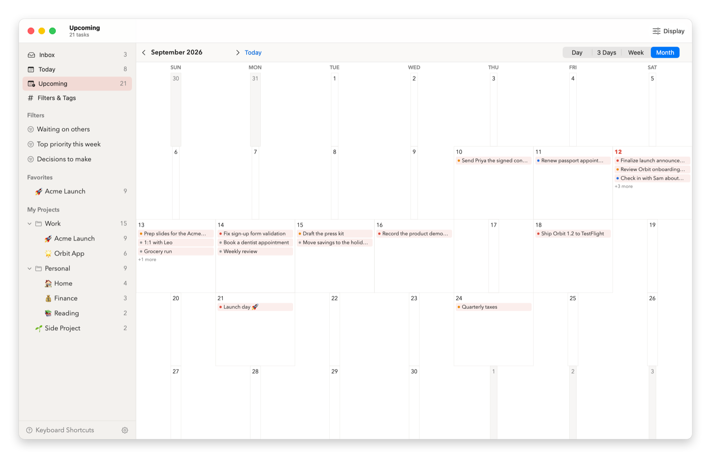
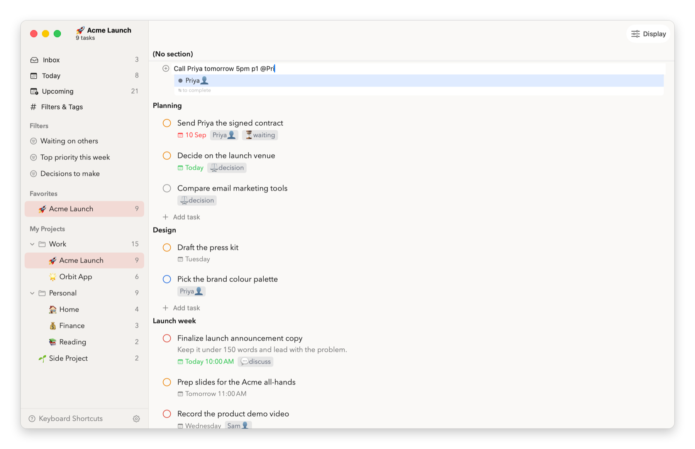
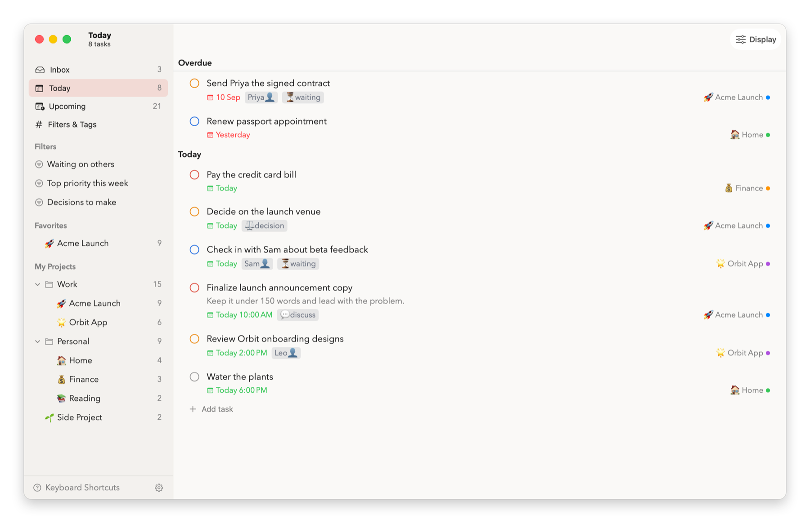
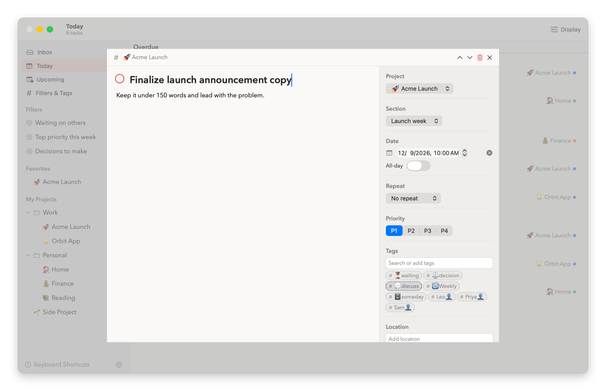
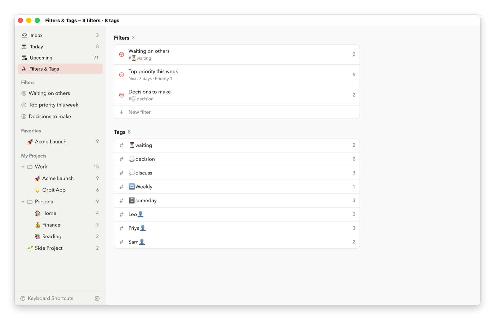
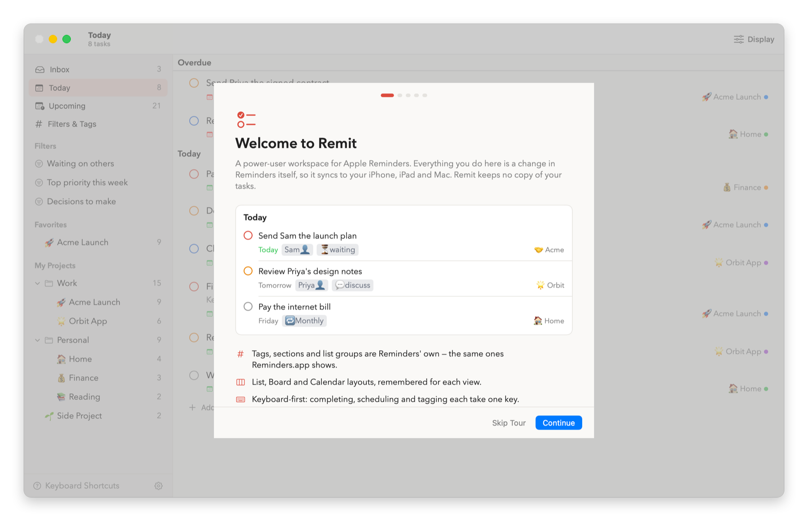

# Remit

**A keyboard-first Mac workspace for Apple Reminders.**

Plan your reminders on boards and a calendar, capture a task in one typed line, and move through
your day without reaching for the mouse — while every task, tag and section stays in Apple
Reminders, synced to your iPhone, iPad and Apple Watch as usual.

> [!NOTE]
> **Remit is vibe-coded.** It is built by directing AI coding tools (Claude Code) rather than by
> writing each line by hand — partly to find out how far that approach can take a real, native
> Mac app. It has a test suite, CI on every change and a release pipeline, and it works on real
> Reminders data. It is also one person's project that relies on a private Apple framework, so
> expect rough edges and read [Limitations](#limitations) before depending on it.



## Why Remit

Apple Reminders is excellent at *holding* your tasks: it syncs everywhere, works with Siri and
your Watch, and understands sections, tags, groups and smart lists. Remit doesn't replace it or
copy your data somewhere else. It is a second window onto the very same Reminders, built for the
moment you sit down at a Mac to plan — in the same family as power-user Reminders apps like
GoodTask.

Keep capturing on your iPhone. Open Remit when it's time to decide what happens this week.

## What Remit adds

### A board for any view

Upcoming becomes a column per day; drag a card to another day to reschedule it. A list's sections
become columns; drag a card to move it between them. Any view can also be grouped into columns by
priority, tag or list, and the Overdue column reschedules everything in it in one step.



### A calendar for your reminders

Day, 3-day, week and month layouts of the tasks you're looking at, inside the same window. Drop a
task on a day to move it there.



### Capture in one line

Type `Call Priya tomorrow 5pm p1 @Priya👤` and Remit sets the date, time, priority and tag at once;
add `#List` to file it and `every monday` to make it repeat. Lists and tags autocomplete as you
type, emoji and all.



### Everything about a task on one row

Today and Upcoming show each task's notes, due date and time, tags and list together, so you can
decide what to do next without opening anything.



### Details, one key away

Press `I` or Return to edit title, notes, date, repeat, priority, tags and section, and step to
the previous or next task without closing the panel.



### Saved filters, and Reminders' own tags

Save a filter by deadline, priority, tag and list, and it becomes a view in the sidebar with a
live count. Tags are the same ones Reminders shows — rename one or remove it from every task in
one place, and the change syncs everywhere.



### Built for the keyboard

Every everyday action is a single key, and every key can be changed in Settings.

| Key | Action | Key | Action |
| --- | --- | --- | --- |
| `Q` or `A` | Quick add | `T` | Due today |
| `E` | Complete | `U` or `M` | Due tomorrow |
| `J` / `K` or `↓` / `↑` | Next / previous task | `W` | Due this weekend |
| `I` or Return | Open details | `N` | Due next week |
| `L` | Edit tags | `0` | Remove the due date |
| `1` – `4` | Priority | `⌘K` | Jump to any list or task |
| `⌘Z` | Undo | `⌘[` / `⌘]` | Back / forward (or swipe) |

### A guided first launch

A short tour explains both permissions Remit asks for and why, and can add a small practice list
to Reminders that teaches each feature by doing it.



## Remit and Apple Reminders

Remit works on top of Reminders, so this isn't a contest: Reminders is where your tasks live, on
every device. The table is what each one offers on a Mac, including what Reminders does better.
Compared against Reminders on macOS 26.

| | Apple Reminders | Remit |
| --- | --- | --- |
| **Your data** | | |
| Tasks, lists, tags, sections and list groups | ✓ | ✓ The same data, read and written in place |
| Syncs to iPhone, iPad and Apple Watch | ✓ | ✓ Through Reminders |
| **Planning** | | |
| Today and scheduled views | ✓ Today, Scheduled | ✓ Today, Upcoming |
| Board of columns | ✓ Per list, by section | ✓ Any view: by day, section, priority, tag or list |
| Calendar layout in the app | — Reminders appear in the Calendar app | ✓ Day, 3 days, week, month; drag to reschedule |
| Group a view by priority, tag or list | Partial — Today and Scheduled group by time | ✓ Any view |
| Sort, manual order, show completed | ✓ | ✓ |
| Reschedule everything overdue at once | ✓ To today | ✓ To today, tomorrow, the weekend or next week |
| **Capture** | | |
| Add a task from anywhere | ✓ Quick Reminder, Siri | — Inside Remit's window |
| List, tags, priority, date, time and repeat in one typed line | Partial — `#tags` in the title | ✓ |
| **Organising** | | |
| Saved filters | ✓ Smart lists — also by location, flag and time | ✓ By deadline, priority, tag and list |
| Rename or remove a tag everywhere | ✓ | ✓ |
| Templates | ✓ Whole lists, with their reminders | Partial — a list's sections |
| Subtasks | ✓ | — Shown as ordinary tasks |
| Flags, early and urgent alerts, locations, assignees, grocery sorting, images | ✓ | — Not shown or editable in Remit |
| **Speed** | | |
| Single-key actions, remappable | — | ✓ |
| Jump to any list or task | Partial — search | ✓ `⌘K` |
| Back and forward through where you've been | — | ✓ Keys or trackpad swipe |
| **Everywhere else** | | |
| iPhone, iPad, Apple Watch, Siri, widgets | ✓ | — Mac only |
| Automation | ✓ Shortcuts, AppleScript | ✓ Anything that automates Reminders works on the same data |
| Cost | Included with macOS | Free and open source (MIT) |

## Install

Requires macOS 14 or later and Apple Reminders.

1. Download the DMG from [Releases](https://github.com/nitezr/Remit-Todo/releases) and drag Remit
   to Applications.
2. The first time, **right-click Remit and choose Open**. Remit isn't notarized yet, so a plain
   double-click is blocked (or run `xattr -dr com.apple.quarantine /Applications/Remit.app`).
3. Follow the welcome tour:
   - **Reminders access**, requested by macOS, lets Remit read and write your lists and tasks.
   - **Full Disk Access** is needed for tags, sections and list groups, because Apple's public
     Reminders API doesn't include them and Remit reads them from Reminders' own database. macOS
     has no prompt for this one: add Remit under System Settings › Privacy & Security › Full Disk
     Access, then reopen Remit. Without it Remit still works, just without tags and sections.

To remove Remit completely — app, settings and both permissions — run `./uninstall.sh` from a copy
of this repository. Your reminders are never touched.

## Try it without your data

Demo mode opens Remit on a made-up workspace and never reads or writes your Reminders. Quit Remit
first, then:

```
open -n /Applications/Remit.app --args --demo 1
```

Every screenshot above comes from demo mode, regenerated with `scripts/screenshots.sh`.

## Limitations

- **Private framework.** Tags, sections and list groups are changed through ReminderKit, the private
  framework Reminders.app itself uses (the approach [RemCTL](https://github.com/viticci/remctl)
  pioneered). A macOS update can break that until Remit is updated, and it is why Remit can't be on
  the App Store.
- **Full Disk Access** is needed to see tags, sections and groups.
- **Not notarized**, so macOS warns on first launch.
- **Mac only.** Subtasks appear as ordinary tasks, and Remit doesn't show or edit flags, locations,
  early and urgent alerts, assignees or images — use Reminders for those.
- **Vibe-coded, one maintainer.** Bugs are likely; issues are welcome.

## Your data

Remit never stores a task, list, tag or section — those live in Apple Reminders and sync through
iCloud like always. Remit keeps only presentation choices Reminders has nowhere to put (saved
filters, templates, list emoji, sidebar order, favourites) in
`~/Library/Application Support/Remit/metadata.json`, with a backup copy on every save. Deleting
that file costs you none of your reminders.

## Development

```
swift build
swift test
```

`./run.sh` builds and launches a development copy. See [docs/architecture.md](docs/architecture.md)
for how Remit talks to Reminders, and [CONTRIBUTING.md](CONTRIBUTING.md) for signing, releases and
data safety.

## Credits

- [RemCTL](https://github.com/viticci/remctl), whose reverse-engineered ReminderKit calls showed how
  to read and write Reminders' tags and sections.
- Built with [Claude Code](https://claude.com/claude-code).

Remit is not affiliated with or endorsed by Apple.

## License

MIT — see [LICENSE](LICENSE).
